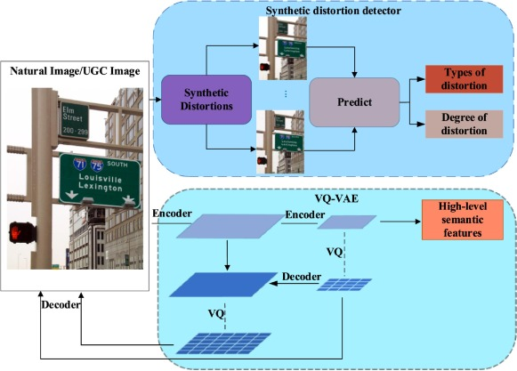

# ECUT-VQA

### Visual Quality Assessment Group

**East China University of Technology**

*Image Quality Assessment · Computer Vision · Deep Learning*

---

**Advancing Visual Quality Assessment through Intelligent Perceptual Modeling**

  <a href="#about-us">About Us</a> |
  <a href="#research-interests">Research Interests</a> |
  <a href="#featured-research-projects">Projects</a> |
  <a href="#publications">Publications</a> |
  <a href="#academic-collaboration">Collaboration</a>

## About Us

Welcome to **ECUT-VQA**, the Visual Quality Assessment Group at **East China University of Technology (ECUT), China**.

Our research focuses on **Image Quality Assessment (IQA)** and **perceptual visual computing**, with particular interests in no-reference image quality assessment, authentic image distortions, and deep learning-based visual quality prediction.

We aim to develop effective and reproducible computational models for understanding and evaluating the perceptual quality of images.

**中文简介**

ECUT-VQA 是东华理工大学视觉质量评价研究团队，主要致力于图像质量评价、真实失真图像感知、深度学习及计算机视觉相关研究。

本主页用于展示团队的学术研究成果、开源代码及相关科研项目，促进学术交流与科研合作。

---

## Faculty

### Assoc. Prof. Tonghan Wang (王同罕)

**Associate Professor | Master's Supervisor**

**East China University of Technology**

Dr. Tonghan Wang received his Ph.D. degree from Southeast University. His research interests include image quality assessment, computer vision, image processing, pattern recognition, and intelligent visual information processing.

His research particularly focuses on perceptual quality evaluation, visual signal processing, and AI-based image analysis.

**Research Interests:**
- Image Quality Assessment (IQA)
- Computer Vision
- Image Processing and Pattern Recognition
- Perceptual Visual Computing

[**Official Faculty Profile**](https://ses.ecut.edu.cn/09/eb/c9824a133611/page.htm)

---

### Assoc. Prof. Huizhen Jia (贾惠珍)

**Associate Professor | Master's Supervisor**

**East China University of Technology**

Dr. Huizhen Jia received her Ph.D. degree from Nanjing University of Science and Technology, specializing in pattern recognition and intelligent systems.

Her research focuses on image processing, pattern recognition, and machine learning, with particular interests in the theoretical and practical applications of intelligent visual analysis.

**Research Interests:**
- Image Processing
- Pattern Recognition
- Machine Learning
- Computer Vision

[**Official Faculty Profile**](https://ies.ecut.edu.cn/0e/06/c2315a69126/page.htm)

---

## Research Interests

Our primary research interests include:

- **No-Reference Image Quality Assessment (NR-IQA)**
- **Authentic Image Distortion Assessment**
- **Deep Learning for Perceptual Quality Prediction**
- **Diffusion Model Priors for Image Quality Assessment**
- **Multi-Scale Visual Feature Extraction and Fusion**

---

## Featured Research Projects

### 1. Dual-Stream Mutually Adaptive Quality Assessment

**Paper:** Dual-stream mutually adaptive quality assessment for authentic distortion image.

**Publication:** Journal of Visual Communication and Image Representation, Vol. 102, 104216, 2024.

This work explores a dual-stream adaptive learning framework for assessing the perceptual quality of authentically distorted images.

  

  <em>Framework of the proposed dual-stream image quality assessment method.</em>

**Resources:**

[**Paper**](https://doi.org/10.1016/j.jvcir.2024.104216) | [**GitHub Repository**](https://github.com/ECUT-VQA/Dual-Stream-Mutually-Adaptive-Quality-Assessment-for-Authentic-Distortion-Image)

### 2. Multi-Scale Hierarchical Adaptive NR-IQA via Diffusion Prior

**Paper Status:** Accepted by the Journal of Image and Graphics (中国图象图形学报) in 2026.

**Scheduled Publication:** 2027

**DOI:** [10.11834/jig.260455](https://doi.org/10.11834/jig.260455)

**Project:** Multi-Scale Hierarchical Adaptive No-Reference Image Quality Assessment via Diffusion Prior.

This research investigates diffusion priors for no-reference image quality assessment, integrating multi-scale feature representations with hierarchical adaptive quality prediction.

  

  <em>Framework of the proposed diffusion-prior-based no-reference image quality assessment method.</em>

**Research Topics:**

- Diffusion-based visual representation
- Multi-scale feature extraction
- Hierarchical adaptive feature fusion
- Perceptual quality prediction

**Resources:**

[**GitHub Repository**](https://github.com/ECUT-VQA/Diffusion-prior-multi-scale-hierarchical-adaptive-no-reference-image-quality-assessment) | [**Implementation Details**](https://github.com/ECUT-VQA/Diffusion-prior-multi-scale-hierarchical-adaptive-no-reference-image-quality-assessment/tree/master)

---

## Publications

### 2026 — Accepted

**Multi-Scale Hierarchical Adaptive No-Reference Image Quality Assessment via Diffusion Prior**

*扩散先验多尺度层级自适应无参考图像质量评价*

**Journal:** Journal of Image and Graphics (中国图象图形学报)

**Status:** Accepted in 2026; scheduled for publication in 2027.

**DOI:** 10.11834/jig.260455

[**Paper**](https://doi.org/10.11834/jig.260455) | [**Code**](https://github.com/ECUT-VQA/Diffusion-prior-multi-scale-hierarchical-adaptive-no-reference-image-quality-assessment) | [**Implementation**](https://github.com/ECUT-VQA/Diffusion-prior-multi-scale-hierarchical-adaptive-no-reference-image-quality-assessment/tree/master)

---

### 2024

**Dual-stream mutually adaptive quality assessment for authentic distortion image.**

*Journal of Visual Communication and Image Representation*, 102, 104216.

[Paper](https://doi.org/10.1016/j.jvcir.2024.104216) | [Code](https://github.com/ECUT-VQA/Dual-Stream-Mutually-Adaptive-Quality-Assessment-for-Authentic-Distortion-Image)

---

## Open Source & Reproducibility

We are committed to sharing research implementations and supporting reproducible research in image quality assessment.

Our repositories provide available source code, implementation details, and experimental resources.

Please refer to the README files of individual projects for environment requirements, dataset preparation, and implementation instructions.

---

## Academic Collaboration

We welcome academic discussions and research collaborations in:

- Image Quality Assessment
- Computer Vision
- Deep Learning
- Perceptual Image Understanding

For questions about individual projects, please visit the corresponding GitHub repositories.

---

### ECUT-VQA

**Visual Quality Assessment Group**

East China University of Technology

*Research · Innovation · Open Source*

